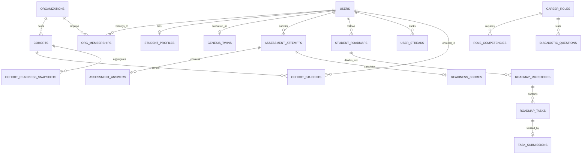
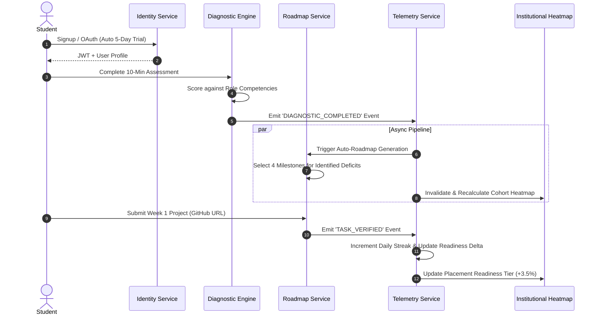

# Digital Twin Verse (DTV) — Unified System Architecture
**Document ID:** DTV-ARCH-2026-v1  
**Timestamp:** 2026-10-28  
**Status:** Approved Architectural Blueprint  
**Target Architecture:** Decoupled High-Velocity SaaS (Vercel Frontend + AWS EC2 Node.js REST API + Neon PostgreSQL Serverless)  
**Scope Alignment:** 30-Day Placement Prep Core Engine (B2C) + Institutional Capacity Connect Pilot (B2B)  
**Constraint:** Architectural specification only. Zero production code modified in this phase.

---

## 1. Architectural Principles & System Context

The strategic audit and business evaluation established that DTV must collapse its fragmented, unmaintained modules (Parent Portal, K-12 guidance, trainer marketplace) into a single, high-performance **Career Readiness & Placement Engine**.

```
  ┌────────────────────────────────────────────────────────────────────────┐
  │                           CLIENT PLATFORMS                             │
  │   ┌───────────────────────────────┐  ┌─────────────────────────────┐   │
  │   │ B2C Student Web Application   │  │ B2B Institutional Portal    │   │
  │   │ (Vanilla JS / Tailwind / PWA) │  │ (TPO Dashboard & Analytics) │   │
  │   └───────────────┬───────────────┘  └──────────────┬──────────────┘   │
  └───────────────────┼─────────────────────────────────┼──────────────────┘
                      │ HTTPS                           │ HTTPS
                      ▼                                 ▼
  ┌────────────────────────────────────────────────────────────────────────┐
  │                         EDGE ROUTING & PROXY                           │
  │   Vercel Edge Network (vercel.json)                                    │
  │   - Static Asset Caching (public/, parent-ui/dist/)                    │
  │   - Security Headers (HSTS, CSP, X-Frame-Options)                      │
  │   - API Proxy Rewrite: /api/* ──(Encrypted HTTPS)──> EC2 Backend       │
  └───────────────────────────────────┬────────────────────────────────────┘
                                      │ Mutual TLS / Encrypted Reverse Proxy
                                      ▼
  ┌────────────────────────────────────────────────────────────────────────┐
  │                      APPLICATION SERVICE LAYER                         │
  │   Node.js 20 LTS / Express API Host (AWS EC2 - 3.110.222.33)           │
  │   ┌───────────────────────┐ ┌──────────────────────┐ ┌───────────────┐ │
  │   │ Auth & RBAC Guard     │ │ Placement Engine     │ │ B2B Multi-    │ │
  │   │ (JWT + Permissions)   │ │ (Diagnostic & Roadmap│ │ Tenant Guard  │ │
  │   └───────────────────────┘ └──────────────────────┘ └───────────────┘ │
  │   ┌───────────────────────┐ ┌──────────────────────┐ ┌───────────────┐ │
  │   │ AI Orchestrator       │ │ Progress Telemetry   │ │ Billing &     │ │
  │   │ (Gemini 1.5 / Anthropic│ │ (Streaks & Badges)  │ │ Webhooks      │ │
  │   └───────────────────────┘ └──────────────────────┘ └───────────────┘ │
  └───────────────────┬───────────────────┬─────────────────┬──────────────┘
                      │                   │                 │
                      ▼                   ▼                 ▼
             ┌─────────────────┐ ┌─────────────────┐ ┌──────────────┐
             │ Neon PostgreSQL │ │ Cloudflare R2   │ │ External APIs│
             │ Serverless DB   │ │ S3-Compatible   │ │ - Razorpay   │
             │ (ap-south-1)    │ │ Object Storage  │ │ - Brevo SMTP │
             └─────────────────┘ └─────────────────┘ └──────────────┘
```

### Core Architecture Principles:
1. **Separation of Concerns:** Eliminate the unstructured `users.app_data` JSON dumping ground. Normalized PostgreSQL relational tables govern all core entities; cached JSON aggregates are strictly used for read-optimized dashboard snapshots.
2. **Tenant Isolation:** Enforce absolute data boundary protection at the database query layer via strict `organization_id` foreign keys and scoped joins.
3. **Data Integrity & Type Safety:** Eliminate type mismatches (e.g., `genesis_twins.user_id` being `INTEGER` while `users.id` is `UUID`). All entity primary keys and user relations use standard `UUIDv4`.
4. **Least-Privilege Security:** Role-Based Access Control (RBAC) enforced via server-side middleware on every route. No client-side role evaluation is trusted.
5. **Deterministic Event Propagation:** State changes (e.g., diagnostic completion $\rightarrow$ roadmap creation $\rightarrow$ streak update $\rightarrow$ institutional telemetry aggregation) are executed within atomic database transactions with asynchronous event emissions for analytics.

---

## 2. Task 1: Module Structure & Domain Boundaries

The system is organized into **13 strictly justified modules** supporting the primary placement-readiness loop and institutional pilot.

```
┌────────────────────────────────────────────────────────────────────────────────────────────────┐
│                                MODULE STRUCTURE & BOUNDARIES                                   │
├────────────────────────────────┬───────────────────────────────┬───────────────────────────────┤
│ Module Name                    │ Primary Purpose               │ Subsumed Legacy Code          │
├────────────────────────────────┼───────────────────────────────┼───────────────────────────────┤
│ 1. Identity & Access (IAM)     │ Auth, JWT, session, 5-day     │ src/controllers/authController│
│                                │ trial provisioning, RBAC      │ src/services/authService      │
│ 2. Student Profile & Twin      │ Unified profile + Genesis     │ src/models/genesisModel       │
│                                │ 5-axis cognitive radar state  │ public/genesis/               │
│ 3. Career Goals & Benchmarks   │ Target role definitions,      │ org_requirements table        │
│                                │ market skill competencies     │ org_skills table              │
│ 4. Diagnostic Assessment       │ 10-min adaptive placement     │ org_assessments, org_questions│
│                                │ diagnostic (logic + tech)     │ org_assessment_attempts       │
│ 5. Explainable Diagnostic      │ Gap calculation, score breakdown, src/services/analyzerEngine │
│                                │ fatal red flags for ATS       │ public/analyzer-script.js     │
│ 6. Targeted Roadmap            │ 4-week structured milestone   │ public/app.js (roadmaps)      │
│                                │ sprint generator              │ org_courses & modules         │
│ 7. Proof Tasks & Projects      │ Verified code & project       │ org_competency_evidence       │
│                                │ deliverable submissions       │ migrations/010_proof_columns  │
│ 8. Progress & Telemetry        │ Daily streaks, milestone delta, src/routes/dataRoutes         │
│                                │ verified readiness badges     │ src/models/leaderboardModel   │
│ 9. AI Simulation & Mentoring   │ AI interview coach, mock code │ src/services/aiService        │
│                                │ reviewer (backend-proxied)    │ src/routes/aiRoutes           │
│ 10. Institutional Multi-Tenant │ College organizations,        │ migrations/012_foundation     │
│                                │ departments, batches/cohorts  │ src/models/organizationModel  │
│ 11. Institutional Reporting    │ TPO cohort readiness heatmap, │ migrations/019_analytics      │
│                                │ unplaced deficit analytics    │ migrations/021_digital_twin   │
│ 12. Billing & Subscriptions    │ Razorpay payment orders,      │ src/controllers/paymentContr. │
│                                │ webhook verifications, passes │ adminSubscriptionRoutes.js    │
│ 13. Audit & Compliance         │ Immutable audit logs, DPDP    │ src/models/auditLogModel      │
│                                │ consent tracking, data purge  │ src/models/consentModel       │
└────────────────────────────────┴───────────────────────────────┴───────────────────────────────┘
```

### Modules Deprecated / Excluded from Target Iteration:
* **Parent Portal (`parent-ui/`):** Code retained in repository but decoupled from primary student authentication and marketing funnels.
* **Trainer Marketplace (`org_trainer_matches`):** Deprecated until institutional demand explicitly requires outsourced instructor staffing.
* **School Class 5–10 Guidance:** Retired to focus engineering bandwidth exclusively on undergraduate placement preparation.

---

## 3. Task 2: Data Ownership & Canonical Entity Models

### 3.1 Entity Relationship Diagram



---

### 3.2 Canonical Data Entities & Ownership Specifications

#### 1. Entity: `users`
* **Data Ownership:** User-owned account identity.
* **Purpose:** System-wide authentication, security credentials, and global role.
* **Schema Definition:**
  ```sql
  CREATE TABLE IF NOT EXISTS users (
      id UUID PRIMARY KEY DEFAULT gen_random_uuid(),
      email VARCHAR(255) UNIQUE NOT NULL,
      password_hash VARCHAR(255),
      name VARCHAR(255) NOT NULL,
      phone VARCHAR(30),
      avatar_url TEXT,
      global_role VARCHAR(50) NOT NULL DEFAULT 'STUDENT' 
          CHECK (global_role IN ('STUDENT', 'PLATFORM_ADMIN')),
      oauth_provider VARCHAR(50),
      oauth_subject VARCHAR(255),
      email_verified BOOLEAN NOT NULL DEFAULT false,
      trial_expires_at TIMESTAMPTZ NOT NULL DEFAULT (NOW() + INTERVAL '5 days'),
      subscription_plan VARCHAR(50) DEFAULT 'FREE_TRIAL',
      subscription_expires_at TIMESTAMPTZ,
      is_active BOOLEAN NOT NULL DEFAULT true,
      created_at TIMESTAMPTZ NOT NULL DEFAULT NOW(),
      updated_at TIMESTAMPTZ NOT NULL DEFAULT NOW(),
      last_login_at TIMESTAMPTZ
  );
  CREATE INDEX idx_users_email ON users(email);
  CREATE INDEX idx_users_subscription ON users(subscription_expires_at, trial_expires_at);
  ```
* **Validation Rules:** Valid RFC 5322 email syntax; no arbitrary domain blacklists; password $\ge 8$ chars with mixed characters.
* **Retention & Purge:** Retained until user initiates account deletion; upon deletion, PII is scrubbed within 30 days per DPDP Act 2023.

#### 2. Entity: `student_profiles`
* **Data Ownership:** Student-owned private profile.
* **Purpose:** Structured academic and career information (replaces `users.app_data`).
* **Schema Definition:**
  ```sql
  CREATE TABLE IF NOT EXISTS student_profiles (
      id UUID PRIMARY KEY DEFAULT gen_random_uuid(),
      user_id UUID UNIQUE NOT NULL REFERENCES users(id) ON DELETE CASCADE,
      institution_name VARCHAR(255),
      degree VARCHAR(100),
      graduation_year INTEGER CHECK (graduation_year BETWEEN 2020 AND 2035),
      current_semester INTEGER CHECK (current_semester BETWEEN 1 AND 10),
      target_role_id UUID REFERENCES career_roles(id) ON DELETE SET NULL,
      target_ctc_lpa NUMERIC(4,2),
      github_url TEXT,
      linkedin_url TEXT,
      resume_file_id UUID REFERENCES files(id) ON DELETE SET NULL,
      skills_inventory TEXT[] DEFAULT '{}',
      created_at TIMESTAMPTZ NOT NULL DEFAULT NOW(),
      updated_at TIMESTAMPTZ NOT NULL DEFAULT NOW()
  );
  CREATE INDEX idx_student_profiles_user ON student_profiles(user_id);
  CREATE INDEX idx_student_profiles_role ON student_profiles(target_role_id);
  ```

#### 3. Entity: `genesis_twins`
* **Data Ownership:** Student-owned capability twin state.
* **Purpose:** Persistent 5-axis capability radar scores (Logic, Creativity, Velocity, Domain, Grit) linked via proper UUID.
* **Schema Definition:**
  ```sql
  CREATE TABLE IF NOT EXISTS genesis_twins (
      id UUID PRIMARY KEY DEFAULT gen_random_uuid(),
      twin_id VARCHAR(64) UNIQUE NOT NULL,
      user_id UUID UNIQUE REFERENCES users(id) ON DELETE CASCADE,
      session_id VARCHAR(128) NOT NULL,
      archetype VARCHAR(128) NOT NULL DEFAULT 'The Analytical Problem Solver',
      confidence NUMERIC(5,2) NOT NULL DEFAULT 85.00,
      radar_scores JSONB NOT NULL DEFAULT '{
          "logic": 70, "creativity": 70, "velocity": 70, "domain": 70, "grit": 70
      }'::jsonb,
      calibration_history JSONB DEFAULT '[]'::jsonb,
      created_at TIMESTAMPTZ NOT NULL DEFAULT NOW(),
      updated_at TIMESTAMPTZ NOT NULL DEFAULT NOW()
  );
  CREATE INDEX idx_genesis_twins_user ON genesis_twins(user_id);
  CREATE INDEX idx_genesis_twins_twin_id ON genesis_twins(twin_id);
  ```
* **Validation Rules:** Each radar score must be an integer between 0 and 100; total confidence between 10.00 and 99.99%.

#### 4. Entity: `career_roles` & `role_competencies`
* **Data Ownership:** Platform-owned global taxonomy.
* **Purpose:** Definitive market benchmarks for placement readiness scoring.
* **Schema Definition:**
  ```sql
  CREATE TABLE IF NOT EXISTS career_roles (
      id UUID PRIMARY KEY DEFAULT gen_random_uuid(),
      role_key VARCHAR(100) UNIQUE NOT NULL, -- e.g., 'SDE_BACKEND_NODE', 'DATA_ANALYST'
      title VARCHAR(255) NOT NULL,
      description TEXT,
      base_benchmark_score INTEGER NOT NULL DEFAULT 75,
      is_active BOOLEAN NOT NULL DEFAULT true,
      created_at TIMESTAMPTZ NOT NULL DEFAULT NOW()
  );

  CREATE TABLE IF NOT EXISTS role_competencies (
      id UUID PRIMARY KEY DEFAULT gen_random_uuid(),
      career_role_id UUID NOT NULL REFERENCES career_roles(id) ON DELETE CASCADE,
      competency_name VARCHAR(255) NOT NULL,
      weight INTEGER NOT NULL CHECK (weight BETWEEN 1 AND 100),
      category VARCHAR(50) NOT NULL CHECK (category IN ('CORE_TECHNICAL', 'SYSTEM_DESIGN', 'LOGIC', 'TOOLING')),
      required_proficiency VARCHAR(50) NOT NULL DEFAULT 'INTERMEDIATE'
  );
  CREATE INDEX idx_role_comp_role ON role_competencies(career_role_id);
  ```

#### 5. Entity: `assessment_attempts` & `readiness_scores`
* **Data Ownership:** Student-owned submission; institution receives aggregate & verified report if student is enrolled in an institutional cohort.
* **Purpose:** Audit trail of diagnostic tests and explainable gap scores.
* **Schema Definition:**
  ```sql
  CREATE TABLE IF NOT EXISTS assessment_attempts (
      id UUID PRIMARY KEY DEFAULT gen_random_uuid(),
      user_id UUID NOT NULL REFERENCES users(id) ON DELETE CASCADE,
      career_role_id UUID NOT NULL REFERENCES career_roles(id) ON DELETE RESTRICT,
      cohort_id UUID REFERENCES cohorts(id) ON DELETE SET NULL,
      attempt_number INTEGER NOT NULL DEFAULT 1,
      started_at TIMESTAMPTZ NOT NULL DEFAULT NOW(),
      completed_at TIMESTAMPTZ,
      status VARCHAR(50) NOT NULL DEFAULT 'IN_PROGRESS' 
          CHECK (status IN ('IN_PROGRESS', 'COMPLETED', 'ABANDONED', 'TIMED_OUT')),
      time_spent_seconds INTEGER DEFAULT 0,
      client_ip_hash VARCHAR(64)
  );
  CREATE INDEX idx_assessment_attempts_user ON assessment_attempts(user_id);
  CREATE INDEX idx_assessment_attempts_cohort ON assessment_attempts(cohort_id);

  CREATE TABLE IF NOT EXISTS readiness_scores (
      id UUID PRIMARY KEY DEFAULT gen_random_uuid(),
      attempt_id UUID UNIQUE NOT NULL REFERENCES assessment_attempts(id) ON DELETE CASCADE,
      overall_readiness_percentage NUMERIC(5,2) NOT NULL,
      technical_score NUMERIC(5,2) NOT NULL,
      logic_score NUMERIC(5,2) NOT NULL,
      flagged_deficits JSONB NOT NULL DEFAULT '[]'::jsonb, -- e.g., ["SQL Indexing", "Async Error Handling"]
      fatal_red_flags JSONB NOT NULL DEFAULT '[]'::jsonb, -- e.g., ["Zero GitHub proof links"]
      ats_resume_score NUMERIC(5,2),
      recommended_action_summary TEXT,
      created_at TIMESTAMPTZ NOT NULL DEFAULT NOW()
  );
  ```

#### 6. Entity: `student_roadmaps`, `roadmap_milestones`, `roadmap_tasks`
* **Data Ownership:** Student-owned customized 4-week placement sprint.
* **Purpose:** The actionable curriculum closing the diagnosed gaps.
* **Schema Definition:**
  ```sql
  CREATE TABLE IF NOT EXISTS student_roadmaps (
      id UUID PRIMARY KEY DEFAULT gen_random_uuid(),
      user_id UUID NOT NULL REFERENCES users(id) ON DELETE CASCADE,
      assessment_attempt_id UUID REFERENCES assessment_attempts(id) ON DELETE SET NULL,
      career_role_id UUID NOT NULL REFERENCES career_roles(id) ON DELETE RESTRICT,
      status VARCHAR(50) NOT NULL DEFAULT 'ACTIVE' CHECK (status IN ('ACTIVE', 'COMPLETED', 'ARCHIVED')),
      target_completion_date DATE NOT NULL,
      created_at TIMESTAMPTZ NOT NULL DEFAULT NOW(),
      updated_at TIMESTAMPTZ NOT NULL DEFAULT NOW()
  );
  CREATE INDEX idx_student_roadmaps_user ON student_roadmaps(user_id);

  CREATE TABLE IF NOT EXISTS roadmap_milestones (
      id UUID PRIMARY KEY DEFAULT gen_random_uuid(),
      roadmap_id UUID NOT NULL REFERENCES student_roadmaps(id) ON DELETE CASCADE,
      week_number INTEGER NOT NULL CHECK (week_number BETWEEN 1 AND 4),
      title VARCHAR(255) NOT NULL,
      core_objective TEXT NOT NULL,
      is_unlocked BOOLEAN NOT NULL DEFAULT false,
      is_completed BOOLEAN NOT NULL DEFAULT false,
      completed_at TIMESTAMPTZ,
      UNIQUE(roadmap_id, week_number)
  );

  CREATE TABLE IF NOT EXISTS roadmap_tasks (
      id UUID PRIMARY KEY DEFAULT gen_random_uuid(),
      milestone_id UUID NOT NULL REFERENCES roadmap_milestones(id) ON DELETE CASCADE,
      task_type VARCHAR(50) NOT NULL CHECK (task_type IN ('PROJECT_BUILD', 'CODE_CHALLENGE', 'MOCK_INTERVIEW', 'RESUME_REWRITE')),
      title VARCHAR(255) NOT NULL,
      description TEXT NOT NULL,
      verification_method VARCHAR(50) NOT NULL CHECK (verification_method IN ('GITHUB_URL', 'QUIZ_SCORE', 'AI_EVALUATION', 'MANUAL_CODE')),
      is_completed BOOLEAN NOT NULL DEFAULT false,
      created_at TIMESTAMPTZ NOT NULL DEFAULT NOW()
  );

  CREATE TABLE IF NOT EXISTS task_submissions (
      id UUID PRIMARY KEY DEFAULT gen_random_uuid(),
      task_id UUID NOT NULL REFERENCES roadmap_tasks(id) ON DELETE CASCADE,
      user_id UUID NOT NULL REFERENCES users(id) ON DELETE CASCADE,
      submission_payload JSONB NOT NULL, -- e.g., {"github_url": "https://github.com/...", "notes": "..."}
      ai_evaluation_score NUMERIC(5,2),
      ai_feedback TEXT,
      status VARCHAR(50) NOT NULL DEFAULT 'SUBMITTED' CHECK (status IN ('SUBMITTED', 'VERIFIED', 'NEEDS_REVISION')),
      submitted_at TIMESTAMPTZ NOT NULL DEFAULT NOW()
  );
  CREATE INDEX idx_task_submissions_task_user ON task_submissions(task_id, user_id);
  ```

#### 7. Entity: `organizations`, `cohorts`, `cohort_students`
* **Data Ownership:** Institution-owned (College / University).
* **Purpose:** Multi-tenant boundaries for pilot institutions and placement cells.
* **Schema Definition:**
  ```sql
  CREATE TABLE IF NOT EXISTS organizations (
      id UUID PRIMARY KEY DEFAULT gen_random_uuid(),
      name VARCHAR(255) NOT NULL,
      slug VARCHAR(100) UNIQUE NOT NULL,
      institution_type VARCHAR(50) NOT NULL DEFAULT 'ENGINEERING_COLLEGE',
      contact_email VARCHAR(255) NOT NULL,
      phone VARCHAR(50),
      status VARCHAR(50) NOT NULL DEFAULT 'ACTIVE' CHECK (status IN ('ACTIVE', 'PILOT', 'EXPIRED', 'SUSPENDED')),
      pilot_starts_at TIMESTAMPTZ,
      pilot_expires_at TIMESTAMPTZ,
      created_at TIMESTAMPTZ NOT NULL DEFAULT NOW(),
      updated_at TIMESTAMPTZ NOT NULL DEFAULT NOW()
  );
  CREATE INDEX idx_organizations_slug ON organizations(slug);

  CREATE TABLE IF NOT EXISTS organization_memberships (
      id UUID PRIMARY KEY DEFAULT gen_random_uuid(),
      organization_id UUID NOT NULL REFERENCES organizations(id) ON DELETE CASCADE,
      user_id UUID NOT NULL REFERENCES users(id) ON DELETE CASCADE,
      role VARCHAR(50) NOT NULL CHECK (role IN ('ORG_ADMIN', 'PLACEMENT_OFFICER', 'FACULTY_MENTOR')),
      department VARCHAR(100),
      status VARCHAR(50) NOT NULL DEFAULT 'ACTIVE',
      created_at TIMESTAMPTZ NOT NULL DEFAULT NOW(),
      UNIQUE(organization_id, user_id)
  );

  CREATE TABLE IF NOT EXISTS cohorts (
      id UUID PRIMARY KEY DEFAULT gen_random_uuid(),
      organization_id UUID NOT NULL REFERENCES organizations(id) ON DELETE CASCADE,
      name VARCHAR(255) NOT NULL, -- e.g., '2026 B.Tech CSE Batch A'
      target_graduation_year INTEGER NOT NULL,
      department VARCHAR(100) NOT NULL,
      created_by UUID REFERENCES users(id) ON DELETE SET NULL,
      created_at TIMESTAMPTZ NOT NULL DEFAULT NOW()
  );
  CREATE INDEX idx_cohorts_org ON cohorts(organization_id);

  CREATE TABLE IF NOT EXISTS cohort_students (
      id UUID PRIMARY KEY DEFAULT gen_random_uuid(),
      cohort_id UUID NOT NULL REFERENCES cohorts(id) ON DELETE CASCADE,
      user_id UUID NOT NULL REFERENCES users(id) ON DELETE CASCADE,
      enrolled_at TIMESTAMPTZ NOT NULL DEFAULT NOW(),
      consent_institutional_reporting BOOLEAN NOT NULL DEFAULT true,
      UNIQUE(cohort_id, user_id)
  );
  CREATE INDEX idx_cohort_students_cohort ON cohort_students(cohort_id);
  CREATE INDEX idx_cohort_students_user ON cohort_students(user_id);
  ```

#### 8. Entity: `audit_logs`
* **Data Ownership:** Platform-owned immutable security log.
* **Purpose:** Non-repudiation, DPDP compliance, and institutional auditing.
* **Schema Definition:**
  ```sql
  CREATE TABLE IF NOT EXISTS audit_logs (
      id UUID PRIMARY KEY DEFAULT gen_random_uuid(),
      actor_user_id UUID REFERENCES users(id) ON DELETE SET NULL,
      organization_id UUID REFERENCES organizations(id) ON DELETE CASCADE,
      action VARCHAR(100) NOT NULL, -- e.g., 'STUDENT_DIAGNOSTIC_COMPLETED', 'BULK_STUDENT_IMPORT'
      target_entity_type VARCHAR(100) NOT NULL,
      target_entity_id UUID,
      ip_address VARCHAR(45),
      user_agent TEXT,
      metadata JSONB DEFAULT '{}'::jsonb,
      created_at TIMESTAMPTZ NOT NULL DEFAULT NOW()
  );
  CREATE INDEX idx_audit_logs_actor ON audit_logs(actor_user_id);
  CREATE INDEX idx_audit_logs_org ON audit_logs(organization_id);
  CREATE INDEX idx_audit_logs_created_at ON audit_logs(created_at);
  ```

---

## 4. Task 3: Role-Based Access Control (RBAC) & Tenant Security

### 4.1 Explicit Defined Roles

```
┌─────────────────────────┬────────────────────────────────────────────────────────────────────────┐
│ Role Key                │ Scope & Responsibility                                                 │
├─────────────────────────┼────────────────────────────────────────────────────────────────────────┤
│ 1. STUDENT              │ Self-serve or institutional student. Access strictly limited to own    │
│                         │ profile, diagnostic attempts, roadmap tasks, and streaks.              │
│ 2. FACULTY_MENTOR       │ Assigned department instructor. Read-only access to assigned cohort   │
│                         │ student readiness scores and task submission artifacts.                │
│ 3. PLACEMENT_OFFICER    │ Training & Placement Officer (TPO). Full read/export access to cohort  │
│    (TPO)                │ readiness deficit heatmaps, placement badges, and student bulk invites.│
│ 4. ORG_ADMIN            │ Dean / College Director. Manage institutional cohorts, assign TPOs,    │
│                         │ view institutional accreditation and pilot conversion telemetry.       │
│ 5. PLATFORM_ADMIN       │ DTV Technical / Operations team. System health, global role benchmarks,│
│                         │ payments reconciliation, and security audit log access.                │
└─────────────────────────┴────────────────────────────────────────────────────────────────────────┘
```

### 4.2 Role-Permission Matrix

| Resource / Action | STUDENT | FACULTY_MENTOR | PLACEMENT_OFFICER | ORG_ADMIN | PLATFORM_ADMIN |
| :--- | :---: | :---: | :---: | :---: | :---: |
| **View Own Student Profile / Twin** | **Own** | No | No | No | Read (Support) |
| **Run Diagnostic Assessment** | **Own** | No | No | No | Test Mode |
| **View Individual Readiness Score** | **Own** | Assigned Cohort | Assigned Cohort | Assigned Cohort | Read All |
| **Submit Roadmap Project / Task** | **Own** | No | No | No | No |
| **Verify / Review Student Tasks** | No | Assigned Cohort | Assigned Cohort | No | Read All |
| **View Cohort Readiness Heatmap** | No | Assigned Cohort | **Full Org** | **Full Org** | Full System |
| **Export TPO Placement Report (CSV/PDF)** | No | Assigned Cohort | **Full Org** | **Full Org** | Full System |
| **Bulk Import Student Cohort (CSV)** | No | No | **Full Org** | **Full Org** | Full System |
| **Manage Org Billing / Pilot Contract**| No | No | Read-only | **Full Org** | Full System |
| **Configure System Career Benchmarks**| No | No | No | No | **Full System** |
| **View Security Audit Logs** | No | No | No | Org-scoped | **Full System** |

### 4.3 Tenant Isolation & Security Enforcement Rules:
1. **Zero Cross-Tenant Leakage:** Every institutional query must join or filter explicitly on `organization_id`. Direct lookups by raw `user_id` without checking the tenant boundary in `organization_memberships` or `cohort_students` are prohibited.
2. **Student PII Boundary:** Students cannot view other students' diagnostic scores or submissions, even within the same cohort. Leaderboards display only pseudonymized public badges or opted-in first names.
3. **Private Mock Interview Protection:** AI mock interview audio/text logs are stored in private S3/R2 keys scoped to `user_id`. Institutional TPOs only receive aggregate competency scores (e.g., *Communication: 80%*), never raw video/chat transcripts, unless explicitly shared by the student.

---

## 5. Task 4: Complete API Contract Specifications

All API routes follow standard RESTful conventions, prefixed with `/api/v1`, using JSON payloads and returning a standardized envelope.

### 5.1 Standard Response Envelope
```json
// Success Response (HTTP 200/201)
{
  "success": true,
  "data": { ... },
  "message": "Operation completed successfully",
  "meta": { "timestamp": "2026-10-28T12:00:00Z" }
}

// Error Response (HTTP 400/401/403/404/422/500)
{
  "success": false,
  "error": {
    "code": "VALIDATION_ERROR",
    "message": "Target role is required",
    "details": [ { "field": "target_role_id", "issue": "Invalid UUID format" } ]
  },
  "meta": { "timestamp": "2026-10-28T12:00:00Z" }
}
```

---

### 5.2 Endpoint Specifications

#### 1. POST `/api/v1/auth/register`
* **Purpose:** Frictionless student onboarding with automatic 5-day trial provisioning.
* **Authentication:** None (Public).
* **Rate Limit:** 5 requests per minute per IP.
* **Request Body:**
  ```json
  {
    "email": "rohan.sharma@gmail.com",
    "password": "SecurePassword123!",
    "name": "Rohan Sharma"
  }
  ```
* **Validation:** Email format RFC 5322 (no domain blacklist); password $\ge 8$ chars; name $\ge 2$ chars.
* **Response (HTTP 201):**
  ```json
  {
    "success": true,
    "data": {
      "user": {
        "id": "e6745f47-b352-474c-83b0-64215f9b4c09",
        "email": "rohan.sharma@gmail.com",
        "name": "Rohan Sharma",
        "global_role": "STUDENT",
        "trial_expires_at": "2026-11-02T12:00:00Z",
        "is_trial_active": true
      },
      "tokens": {
        "access_token": "eyJhbGciOi...",
        "expires_in": 3600
      }
    }
  }
  ```

#### 2. POST `/api/v1/student/twin/calibrate`
* **Purpose:** Initialize or update the Genesis 5-axis capability radar scores without database type errors.
* **Authentication:** Required (Bearer JWT).
* **Request Body:**
  ```json
  {
    "session_id": "gen_sess_8921a",
    "scores": {
      "logic": 82,
      "creativity": 74,
      "velocity": 88,
      "domain": 65,
      "grit": 90
    },
    "archetype": "The Strategic Architect",
    "confidence": 91.50
  }
  ```
* **Validation:** All 5 score dimensions must be integers $0 \le x \le 100$.
* **Response (HTTP 200):**
  ```json
  {
    "success": true,
    "data": {
      "twin_id": "DTV-GEN-4912-K",
      "user_id": "e6745f47-b352-474c-83b0-64215f9b4c09",
      "archetype": "The Strategic Architect",
      "radar_scores": {
        "logic": 82, "creativity": 74, "velocity": 88, "domain": 65, "grit": 90
      },
      "confidence": 91.50,
      "updated_at": "2026-10-28T12:15:00Z"
    }
  }
  ```

#### 3. POST `/api/v1/assessments/start`
* **Purpose:** Initiate a 10-minute adaptive placement diagnostic for a selected career role.
* **Authentication:** Required (Bearer JWT; user must have active trial or subscription).
* **Request Body:**
  ```json
  {
    "career_role_key": "SDE_BACKEND_NODE",
    "cohort_id": null
  }
  ```
* **Response (HTTP 201):**
  ```json
  {
    "success": true,
    "data": {
      "attempt_id": "9bc321fe-7d23-41bb-b892-049817ad901a",
      "duration_minutes": 10,
      "total_questions": 10,
      "questions": [
        {
          "question_id": "3f821094-a120-410a-80c1-39820fbc0112",
          "order_index": 1,
          "question_text": "What occurs if an unhandled promise rejection occurs in Node.js 18+?",
          "question_type": "MCQ_SINGLE",
          "options": [
            { "id": "opt_1", "text": "The process crashes immediately with exit code 1" },
            { "id": "opt_2", "text": "It emits a warning and continues running" },
            { "id": "opt_3", "text": "It automatically retries the operation" }
          ]
        }
      ]
    }
  }
  ```

#### 4. POST `/api/v1/assessments/:attemptId/submit`
* **Purpose:** Complete diagnostic, evaluate answers against market benchmarks, and calculate the explainable readiness score.
* **Authentication:** Required (Bearer JWT; owner of attempt).
* **Request Body:**
  ```json
  {
    "answers": [
      { "question_id": "3f821094-a120-410a-80c1-39820fbc0112", "selected_option_id": "opt_1" }
    ],
    "time_spent_seconds": 540
  }
  ```
* **Response (HTTP 200):**
  ```json
  {
    "success": true,
    "data": {
      "attempt_id": "9bc321fe-7d23-41bb-b892-049817ad901a",
      "overall_readiness_percentage": 72.50,
      "technical_score": 68.00,
      "logic_score": 85.00,
      "flagged_deficits": [
        "Database Indexing Strategies (B-Tree vs Hash)",
        "Async Error Handling Middleware"
      ],
      "fatal_red_flags": [
        "No live GitHub repository demonstrating REST API deployment"
      ],
      "ats_resume_score": 65.00,
      "roadmap_ready": true
    }
  }
  ```

#### 5. GET `/api/v1/roadmap/current`
* **Purpose:** Retrieve the active 4-week gap-closing sprint and actionable proof-of-work tasks.
* **Authentication:** Required (Bearer JWT).
* **Response (HTTP 200):**
  ```json
  {
    "success": true,
    "data": {
      "roadmap_id": "6210f92b-34a1-4328-980b-df712890a821",
      "career_role": "Backend Node.js Engineer",
      "current_week": 1,
      "milestones": [
        {
          "week_number": 1,
          "title": "Backend Architecture & Robust Error Handling",
          "core_objective": "Build and deploy a resilient REST API with structured logging and database pooling",
          "is_unlocked": true,
          "is_completed": false,
          "tasks": [
            {
              "task_id": "a90184b2-c821-4921-b012-984210dfa120",
              "task_type": "PROJECT_BUILD",
              "title": "Deploy Express API with Postgres Connection Pool & Health Check",
              "verification_method": "GITHUB_URL",
              "is_completed": false
            }
          ]
        }
      ]
    }
  }
  ```

#### 6. POST `/api/v1/ai/interview/message`
* **Purpose:** Securely proxy AI interview coach interactions through the backend, avoiding client-side API key exposures.
* **Authentication:** Required (Bearer JWT; active trial or subscription).
* **Rate Limit:** 20 messages per minute per user.
* **Request Body:**
  ```json
  {
    "conversation_id": "conv_98210_a",
    "role_key": "SDE_BACKEND_NODE",
    "user_message": "In Node.js, the event loop handles async I/O via libuv worker threads."
  }
  ```
* **Response (HTTP 200):**
  ```json
  {
    "success": true,
    "data": {
      "ai_response": "Accurate! Libuv delegates file system I/O and DNS lookups to its worker thread pool while network I/O is handled directly by OS epoll/kqueue. Now, how would you prevent thread pool starvation in a high-load app?",
      "feedback_delta": {
        "technical_accuracy": 92,
        "communication_clarity": 88
      }
    }
  }
  ```

#### 7. GET `/api/v1/org/cohorts/:cohortId/heatmap`
* **Purpose:** TPO aggregate dashboard displaying cohort readiness distribution and skill gap frequencies.
* **Authentication:** Required (Bearer JWT with `PLACEMENT_OFFICER` or `ORG_ADMIN` role for the parent organization).
* **Response (HTTP 200):**
  ```json
  {
    "success": true,
    "data": {
      "cohort_name": "2026 B.Tech CSE Batch A",
      "total_students": 112,
      "assessed_students": 89,
      "average_readiness_score": 68.4,
      "readiness_tiers": {
        "placement_ready_gt_80": 24,
        "near_ready_65_to_80": 46,
        "high_risk_lt_65": 19
      },
      "top_cohort_skill_deficits": [
        { "skill": "SQL Indexing & Query Optimization", "unmet_percentage": 68.5 },
        { "skill": "System Design Caching (Redis)", "unmet_percentage": 59.2 },
        { "skill": "Docker Containerization", "unmet_percentage": 52.8 }
      ]
    }
  }
  ```

---

## 6. Task 5: Integration Architecture & Event Propagation

### 6.1 Unified Data Lineage & Event Pipeline

Every stage of the student workflow feeds deterministically into the next, ensuring complete data consistency across the student dashboard and institutional analytics.



### 6.2 Data Change Propagation Mechanics

1. **Transactional Boundaries:**
   * An assessment submission writes `assessment_attempts`, `assessment_answers`, and `readiness_scores` within a single PostgreSQL ACID transaction (`BEGIN ... COMMIT`). If scoring fails, no partial attempt is recorded.
2. **Event Dispatching via Node.js EventEmitter:**
   * Asynchronous event handlers in `LiveSyncService` listen for domain events (`DIAGNOSTIC_COMPLETED`, `TASK_SUBMITTED`, `STREAK_INCREMENTED`).
   * Event handlers update read-optimized caches and institutional aggregates asynchronously without blocking the client response.
3. **Database Connection Pool Safety:**
   * Replaces ad-hoc queries with strict connection release guards (`try { ... } finally { client.release(); }`) to eliminate the pool exhaustion leaks identified during the baseline audit.

---

## 7. Task 6: Dependency-Aware Implementation Sequence

To safely execute this transformation without service interruption, the roadmap is structured into **6 sequential, dependency-checked phases**.

```
  ┌────────────────────────────────────────────────────────────────────────┐
  │ PHASE 1: SECURITY HARDENING & TEST ISOLATION (Days 1–3)                │
  │ - Create isolated .env.test runner; eliminate production Neon tests.   │
  │ - Remove hardcoded payment IDs in paymentController.js.                │
  │ - Proxy Analyzer AI requests via backend API (/api/public-analyzer).   │
  └───────────────────────────────────┬────────────────────────────────────┘
                                      │
                                      ▼
  ┌────────────────────────────────────────────────────────────────────────┐
  │ PHASE 2: SCHEMA NORMALIZATION & TYPE UNIFICATION (Days 4–7)            │
  │ - Migration 025: Unify genesis_twins.user_id to UUID.                  │
  │ - Migration 026: Create career_roles, student_profiles, roadmaps.      │
  │ - Deploy backward-compatible view / adapter for users.app_data.        │
  └───────────────────────────────────┬────────────────────────────────────┘
                                      │
                                      ▼
  ┌────────────────────────────────────────────────────────────────────────┐
  │ PHASE 3: ONBOARDING UNBLOCKING & TRIAL PROVISIONING (Days 8–11)        │
  │ - Remove email domain blacklist in authController.js.                  │
  │ - Provision 5-day trial automatically on user registration.            │
  │ - Enable free-tier data sync on GET/PUT /api/v1/data/me.               │
  └───────────────────────────────────┬────────────────────────────────────┘
                                      │
                                      ▼
  ┌────────────────────────────────────────────────────────────────────────┐
  │ PHASE 4: 8-STAGE CORE PLACEMENT LOOP (Days 12–19)                      │
  │ - Connect Genesis twin calibration directly to Student Profile.        │
  │ - Wire adaptive 10-minute diagnostic to Explainable Readiness Score.   │
  │ - Generate personalized 4-week roadmap from flagged deficits.          │
  └───────────────────────────────────┬────────────────────────────────────┘
                                      │
                                      ▼
  ┌────────────────────────────────────────────────────────────────────────┐
  │ PHASE 5: INSTITUTIONAL TPO PILOT PORTAL (Days 20–25)                   │
  │ - Build unauthenticated /organization/overview public landing page.    │
  │ - Implement CSV student bulk onboarding for TPOs.                      │
  │ - Deliver TPO Cohort Readiness Deficit Heatmap dashboard.             │
  └───────────────────────────────────┬────────────────────────────────────┘
                                      │
                                      ▼
  ┌────────────────────────────────────────────────────────────────────────┐
  │ PHASE 6: CI/CD PIPELINE, CODE QUALITY & VALIDATION (Days 26–30)        │
  │ - Fix 15 ESLint errors in parent-ui/src/.                              │
  │ - Configure GitHub Actions CI workflow (lint + test + build check).    │
  │ - Archive 60+ legacy scratch scripts into scripts/ops/archive/.        │
  └────────────────────────────────────────────────────────────────────────┘
```

### 7.1 Database Migration Plan

#### Migration 025: `migrations/025_unify_twin_and_user_types.sql`
* **Changes:**
  * Alter `genesis_twins.user_id` from `INTEGER` to `UUID REFERENCES users(id) ON DELETE CASCADE`.
  * Add `trial_expires_at TIMESTAMPTZ DEFAULT (NOW() + INTERVAL '5 days')` to `users`.
* **Backward Compatibility:** Existing `genesis_twins` rows with integer IDs are backfilled by matching `session_id` against user session tokens.

#### Migration 026: `migrations/026_placement_engine_core.sql`
* **Changes:**
  * Create `career_roles`, `role_competencies`, `student_profiles`, `student_roadmaps`, `roadmap_milestones`, `roadmap_tasks`, and `task_submissions`.
  * Establish foreign key indices on all relationship columns.
* **Backward Compatibility:** `users.app_data` remains readable; a background sync reads `app_data` to populate `student_profiles` during initial user login.

### 7.2 Testing & Quality Gates
* **Automated Test Suite:** Add end-to-end tests covering:
  1. Student signup $\rightarrow$ 5-day trial verified $\rightarrow$ no premature paywall.
  2. Diagnostic completion $\rightarrow$ readiness score $\rightarrow$ roadmap generation.
  3. TPO CSV cohort import $\rightarrow$ cohort heatmap aggregation.
* **Rollback Safeguards:**
  * All database migrations must include down-migration scripts (`025_rollback.sql`, `026_rollback.sql`).
  * Backend deploys on AWS EC2 utilize zero-downtime PM2 reload with Git commit tagging (`v2026.10-release`).

---

## 8. Summary of Architectural Decisions

1. **Clean Domain Boundaries:** Eliminated the anti-pattern of serializing application state into `users.app_data`. Domain tables now cleanly govern profiles, assessments, roadmaps, and submissions.
2. **Frictionless Top-of-Funnel:** Fixed the Day-1 paywall lockout by embedding an automatic 5-day trial in the core identity schema and removing the arbitrary email domain restriction.
3. **Type Safety & Reliability:** Reconciled the fatal UUID vs. Integer mismatch in Genesis twin records, eliminating in-memory fallback bugs and live database errors.
4. **Institutional B2B Readiness:** Multi-tenant cohort structures (`organizations`, `cohorts`, `cohort_students`) enable secure, private institutional pilots with zero cross-tenant data leakage.
5. **Decoupled Deployment Integrity:** Retained the Vercel (static edge) + AWS EC2 (Node API) + Neon (Serverless Postgres) architecture without introducing expensive or unnecessary infrastructure complexity.
